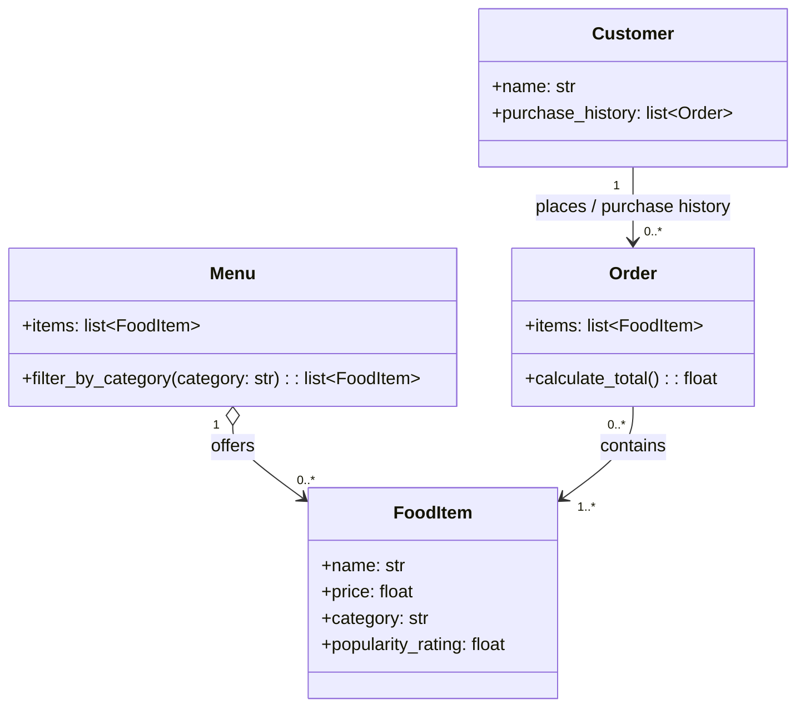

# ByteBites UML Class Diagram

Each order belongs to one customer and contains at least one food item. A food item may appear in many orders. The numeric types are modeling assumptions; the specification does not define exact types.
